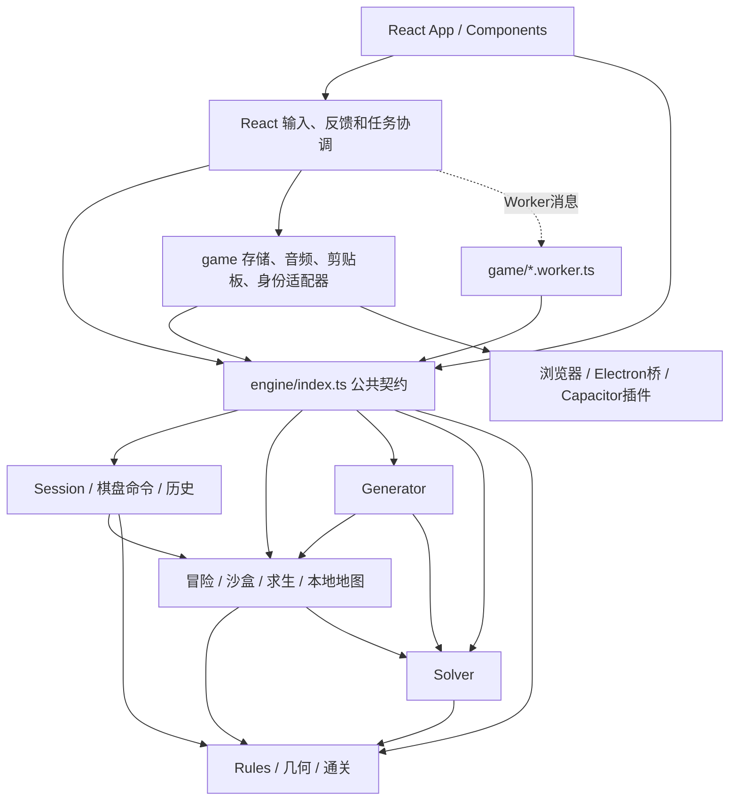

# Wildgrid Engine 架构

Wildgrid 的 Web/PWA、Windows Electron、Android Capacitor 共用同一套纯 TypeScript 游戏核心。公共入口是 `src/engine/index.ts`。本次审计、逐文件职责、迁移与验证见 `reports/engine-audit.md`、`reports/engine-file-inventory.md` 和 `reports/engine-migration.md`。

## 分层与依赖



引擎内部直接导入实现模块，不导入自己的公共barrel；外部统一从`engine`或`engine/index`导入。引擎只读取本地静态关卡数据，不导入React、Hooks、DOM、平台存储或原生能力。没有通用Engine基类、全局事件总线或额外仓库框架。

## 实际目录与职责

```text
src/engine/
  index.ts                公共API与类型导出
  types.ts                Level/Piece/Placement/Snapshot等共同契约
  session.ts              createSession、命令、80步历史、查询与业务事件
  rules.ts                唯一形状/旋转/邻接/设施和地形约束/行列/通关
  placementValidation.ts  strict/recover记录格式与几何校验
  placementHints.ts       调用正式规则的落点提示预测
  levels.ts               原45关与答案的ID查询
  facilityRegistry.ts     稳定设施模板/允许形状及展示元数据
  solver.ts               位集合求解、唯一解与搜索统计
  sandbox.ts              编辑归一化、完整蓝图校验、WG1和自检
  survivalGenerator.ts    原随机生成、难度筛选、时间与节点预算
  adventure.ts            冒险v1协议、恢复、解锁与进度变更
  survival.ts             求生模型、难度/XP、协议、归档及状态转移
  localMaps.ts            本地地图协议、权限、命名/图标及CRUD纯变更
  mapIcons.ts             稳定地图图标ID和数据校验
src/game/
  storage.ts              冒险localStorage读写及失败保护
  survival.ts             求生读写、最新账本+结算单次写入
  localMaps.ts            收藏读写及显式传入最新求生快照
  sandbox.worker.ts       自检消息桥
  survival.worker.ts      生成消息桥
  audio.ts                Web Audio播放与可见性
  clipboard.ts            Web/Electron/Android剪贴板
  playerId.ts             原生匿名身份桥
  tutorial.ts             UI教学日程、语义目标和偏好存储
```

`src/data`、视觉组件、CSS、字体和徽章不迁移。教程具有DOM目标、旁白、语言及界面步骤，继续属于UI流程；它从引擎读取类型/关卡，不成为游戏规则来源。

## Session API与状态所有权

```ts
import { createSession, dispatch, getLevelById, getState } from './engine';

let session = createSession({
  mode: 'adventure',
  present: { level: getLevelById(1)!, placements: [] },
});
const outcome = dispatch(session, {
  type: 'place', piece: session.present.level.pieces[0],
  cell: { r: 2, c: 3 }, rotation: 0,
});
if (!outcome.error) session = outcome.session;
const { level, placements, result } = getState(session);
```

`GameSession`包含mode、past、present、future；`Snapshot`统一包含level和placements，`SandboxDraft`只是同一契约的语义别名。Session是纯数据值，`dispatch`返回新值，拒绝时保留原session并给出`error.code/message`、反馈cells；成功给出包含操作类型、设施ID及坐标的events。`getState`提供权威规则结果，`getAvailableActions`提供undo/redo及未放设施。事件供调用者追踪，不触发声音、存储或React effect。

命令列表：

| 命令 | 数据/行为 |
|---|---|
| place | piece、cell、rotation；正式模式使用关卡真实库存，editor允许注册表支持的新实例 |
| remove | id；editor同步移除实例及更新目标，正式模式回库存 |
| rotate | id、pivot；保留原支点语义，几何冲突不改变快照 |
| terrain | cell、可选kind；仅editor，指定kind切换同格地形，省略kind移除 |
| clear | 清空设施，可撤销；editor保留地形并清空设施/目标 |
| undo / redo | 共用80步历史；分支操作清空future |

只有越界、覆盖地形、重叠、未知/重复设施或格式错误阻止命令；关系或行列规则INVALID/INCOMPLETE仍可落下并继续编辑。editor只在命令提交时执行`withEditorPlacements`，反馈读取同一返回快照。预览对纯dispatch结果只读，不提交到当前session。

React `useGameHistory`只持有引擎返回的一个session值；ref和state指向同一对象以支持同一事件内连续命令，不各自计算棋盘。UI不得原地修改session、level或placements，也不保留另一份可写棋盘。保留Level/Snapshot引用共享，避免破坏原教学、庆祝按引用判断的生命周期。selected、hover、未落子方向、临时自定义设施ID、导航和弹窗是UI状态；存档中的progress是持久化投影，不是第二份可操作棋盘。

## 公共API清单

| 能力/权威实现 | 公共API |
|---|---|
| Session / session.ts | createSession、dispatch、getState、getAvailableActions；GameSession/GameCommand/GameEvent/CommandResult |
| Rules / rules.ts | evaluate、placementBlock、placementHints（实现位于placementHints.ts）；key、adjacent、offsets、occupied、rotateAround |
| 放置记录 / placementValidation.ts | validatePlacements；PlacementValidationError/Result |
| Level / levels.ts | levels、solutions、getLevelById、getSolution；不存在ID返回undefined |
| 设施 / facilityRegistry.ts | facilityLibrary、facilities、facilityRegistry、facilityNames、facilityTips、shapeNames、terrainNames；描述不执行规则 |
| Solver / solver.ts | solveLevel、countSolutions、SolverResult；预算超时/节点中止通过aborted报告 |
| 沙盒 / sandbox.ts | createSandbox、withEditorPlacements（批量草稿构造）、checkSandbox、encodeMap、decodeMap；SandboxDraft/SandboxCheck |
| Generator / survivalGenerator.ts | generateSurvival、survivalGenerationTimeout；原种子、随机调用、难度/预算保留 |
| 冒险 / adventure.ts | createAdventureSave、parseAdventureSave、adventureSaveWritable、levelUnlocked、progressForPlay、recordAdventureProgress、completeAdventureLevel、adventureStartSnapshot |
| 求生查询 / survival.ts | survivalDifficulties、survivalRanks、rankFor、survivalTotals、survivalFingerprint、emptySurvivalProgress、createSurvivalSave |
| 求生协议/流程 / survival.ts | parseSurvivalSave、parseSurvivalForWrite、serializeSurvivalSave、archiveSurvivalRecord、settleSurvival、updateSurvivalProgress、replaceSurvivalChallenge、abandonSurvivalChallenge、restartSurvivalChallenge |
| 本地地图 / localMaps.ts | parseLocalMapsSave、parseLocalMapsForWrite、serializeLocalMaps、upsertLocalMap、unlockSurvivalMapEntries、removeLocalMap、renameLocalMapEntry、setLocalMapEntryIcon、survivalCollectionTarget |
| 地图图标 / mapIcons.ts | mapIconChoices、isMapIcon及MapIconId |

纯核心函数与存储适配函数是不同边界：例如`settleSurvival(latest,challenge,placements,at)`计算返回值，`game/survival.completeSurvival`读取最新账本、调用它并一次写盘。适配器没有第二套奖励计算。地图/协议错误沿用原异常和中文消息；高频游戏操作使用结构化命令结果，没有把所有错误强行改成新契约。

## 模式、存档与平台

冒险复用固定关卡、解锁链、未完成恢复和已解关卡重入重置。沙盒编辑自动生成pieces/rows/cols，游玩使用原始蓝图且不影响主线/求生。荒野保留生成后成功写盘才替换、失败保留旧挑战、放弃归档、收藏原图、通关一次奖励、重复完成幂等、旧past/future/方向/选择恢复。

| 存储协议 | 所有权与兼容 |
|---|---|
| wildgrid-save-v1 | Engine负责字段归一化/几何recover/进度和解锁，adapter保留读失败标记和未来版本防覆盖 |
| wildgrid-local-maps-v1 | Engine校验地图/严格progress，显式接收SurvivalSave推导图纸锁；放弃后读取自动解锁，不要求第二次写盘 |
| wildgrid-survival-v1 | Engine校验账本/挑战/WG1/80步历史/40指纹；adapter读最新+单次结算写入，存储失败不报告奖励成功 |
| WG1: | 原v/s/t/f/r/c、稳定设施模板ID和实例ID；UTF-8 JSON/无填充Base64URL，未改格式 |

三个存档键、version:1、地图/关卡/挑战ID及损坏/未来版本保护保持。标准编码用TextEncoder/Decoder及atob/btoa，支持现有Web/Worker/Node运行环境；没有浏览器特定存储接口。未引入新的存储抽象，纯函数接受数据值，现有适配器实际读写。

音效、剪贴板、Worker创建/取消/超时、crypto种子/ID、Date.now时间取值、PWA注册、Electron协议/IPC、Android原生插件及匿名玩家ID全部保留平台层。引擎不调用它们；结算时刻作为值传入。Web/Electron/Android同一bundle使用同一公共API，各平台原存储位置独立。

## 单一实现源与扩展约定

- 形状、占格、旋转、地形/设施关系、行列和通关只定义在rules。Solver编译同一设施冲突/营地连接，不复制tower/fire/picnic规则，完整解继续evaluate复核。
- 棋盘操作/历史只定义在session；UI执行命令，不再追加/过滤placements或重建editor目标。
- 关卡JSON与levels查询是唯一运行数据；创作脚本保留原node入口，经已安装tsx导入公共Engine occupied，前15关创作/后30关保留行为不变。
- 奖励、解锁、地图权限和协议校验只定义在对应Engine模式模块；Hook协调异步任务和实际读写，adapter不复制业务。
- `tests/engine-boundaries.test.ts`检查反向/外部依赖、平台全局、私有路径导入和核心循环；Session/模式测试验证关键状态转移，既有规则/存档测试继续复用。
- 新设施优先修改types/registry和rules，必要搜索优化从权威定义编译；新模式复用Session，不引入模式基类或第二套规则。新增关卡保持稳定ID并执行现有校验。
