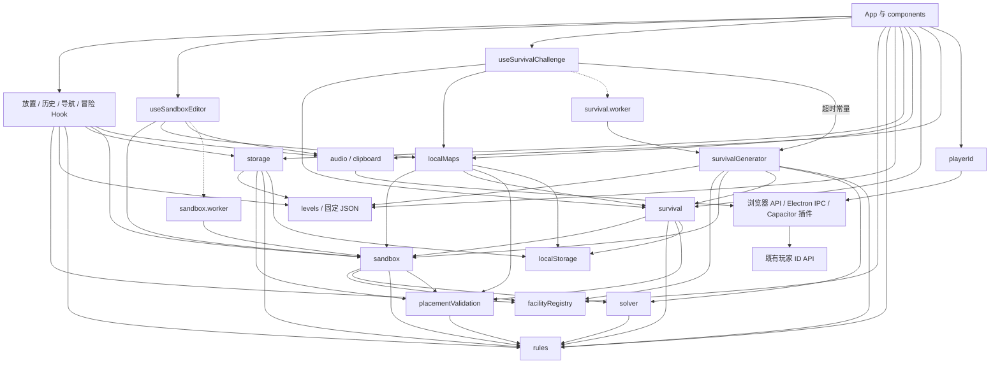

# Wildgrid 架构

同一份 React 应用运行于 Web/PWA、Windows Electron 与 Android Capacitor。各模式共享 `Level`、`Piece`、`Placement` 和正式规则；模式控制、存档与平台能力各有明确入口。

## 分层与目录

UI 展示数据并发出操作；Hook 管理状态转换、历史和异步任务；游戏核心计算几何、规则与解；持久化模块维护各模式协议；平台适配模块处理音频、剪贴板和身份。`App.tsx` 组合这些接口，保留页面、弹窗、键盘和视觉状态的绑定。

```text
Wildgrid/
├── src/
│   ├── main.tsx                  React 启动、样式与 Web Service Worker 注册
│   ├── App.tsx                   页面组装、模式接口连接、提示与弹窗
│   ├── components/
│   │   ├── Art.tsx               共享 SVG 地形、设施、占格与风景
│   │   ├── Blueprint.tsx         参考图纸展示
│   │   ├── Manual.tsx            注册表驱动的设施手册
│   │   ├── SandboxMenu.tsx       模式选择、导入与本地地图管理界面
│   │   ├── SandboxArt.tsx        沙盒菜单插画
│   │   ├── SurvivalMenu.tsx      求生难度、经验与通关记录展示
│   │   └── SurvivalBadge.tsx     身份徽章展示
│   ├── hooks/
│   │   ├── useAdventureProgress.ts 冒险进度、设置、完成记录与自动写盘
│   │   ├── useGameHistory.ts     快照、80 步操作历史、撤销、重做与恢复
│   │   ├── useGameNavigation.ts  页面、模式、当前关卡与返回目标
│   │   ├── useGamePlacement.ts   设施选择、放置、拿起、旋转与棋盘预览
│   │   ├── useSandboxEditor.ts   草稿、本地地图上下文、自检、保存与导出
│   │   └── useSurvivalChallenge.ts 生成、继续、替换、放弃、收藏、结算与自动存档
│   ├── game/
│   │   ├── types.ts              共享类型
│   │   ├── facilityRegistry.ts   名称、允许形状、展示文案、图鉴与稳定设施模板
│   │   ├── rules.ts              唯一正式规则、几何和胜负判定
│   │   ├── placementValidation.ts 统一放置记录格式与几何校验
│   │   ├── levels.ts             固定关卡、参考答案与 ID 查询
│   │   ├── solver.ts             位运算搜索、剪枝与正式规则复核
│   │   ├── sandbox.ts            草稿目标生成、自检、WG1 编解码
│   │   ├── sandbox.worker.ts     隔离耗时沙盒自检
│   │   ├── survivalGenerator.ts  既有随机挑战生成算法
│   │   ├── survival.worker.ts    隔离耗时挑战生成
│   │   ├── storage.ts            冒险存档与既有解锁关系
│   │   ├── localMaps.ts          本地地图持久化、名称、收藏与图纸标志
│   │   ├── survival.ts           求生存档、难度、身份、奖励与通关账本
│   │   ├── audio.ts              原创 Web Audio 音乐、交互音效与后台暂停
│   │   ├── clipboard.ts          Web/Electron/Android 剪贴板适配
│   │   └── playerId.ts           既有匿名玩家 ID 平台入口
│   ├── data/{levels,solutions}.json 固定 45 关与原始参考答案
│   ├── assets/survival-badges/    原有徽章 SVG
│   ├── {styles,viewport,sandbox,survival}.css 原有样式
│   └── vite-env.d.ts             环境声明
├── electron/{main,preload}.cjs    Windows 容器、资源协议与原生桥
├── android/                      Capacitor 工程与原生身份/剪贴板插件
├── server/                       既有玩家 ID API 与部署配置
├── scripts/                      固定关卡维护、校验、图标、打包和下载部署
├── tests/                        核心回归、Electron UI 与 viewport 手工入口
├── public/                       PWA、图标与静态资源
├── build/、reports/              打包资源及仍用于维护/验证的资料
├── README.md                     运行、玩法与平台操作
└── ARCHITECTURE.md               本文
```

`game/` 按文件区分纯计算、存档及平台边界，没有为层次额外创建空目录。`rules.ts`、`solver.ts`、`placementValidation.ts`、`sandbox.ts` 的计算接口不依赖 React、DOM 或 localStorage；Worker 只执行自检或生成并返回结果。注册表只依赖类型，规则模块不依赖注册表；展示文案不能用于执行规则。

## 依赖方向

箭头表示调用或读取；Worker 虚线表示消息与结果往返。Hook 之间通过 `App` 注入的明确操作回调连接，不直接改另一 Hook 的内部状态。



## 运行流程与模式复用

玩家点击 UI → `useGamePlacement` 调用 `placementBlock()` 检查几何 → 提交快照到 `useGameHistory` → `evaluate()` 返回行列占格、设施状态及胜负 → React 展示新状态 → 对应模式在业务边界存档。覆盖地形、重叠和越界阻止操作；环境关系或行列提示暂未满足时，摆放保留供继续调整。

- **冒险**：`useAdventureProgress.getStartSnapshot()` 按 ID 取固定关卡并恢复未完成棋盘；已解出的关卡重新进入时从空棋盘开始。App 的布局 effect 调用 `recordProgress()`，Hook 的布局 effect 写冒险存档；通关调用 `completeLevel()`，解锁仍由 `levelUnlocked()` 实现。
- **沙盒**：编辑和游玩使用同一套放置与历史。编辑提交经 `withEditorPlacements()` 更新设施清单及行列目标；`useSandboxEditor` 在 Worker 中自检，只有唯一解结果才能保存/导出。导入或本地游玩共享正式规则，独立于冒险和求生奖励。编辑草稿仍需显式保存，修改或返回会取消旧自检，剪贴板异步结果受 revision 约束。
- **荒野求生**：`useSurvivalChallenge` 启动生成 Worker，成功且写盘后进入游戏；继续挑战恢复棋盘、历史、方向与选择。布局 effect 保存当前挑战状态；通关经 `completeSurvival()` 在同一次 localStorage 写入中保存账本，并移除 ID 匹配的未完成挑战，再刷新收藏。生成超时、取消、失败保留旧挑战；Worker 身份检查防止过期结果生效。

模式切换由 `useGameNavigation` 决定页面/模式，App 连接历史恢复、交互重置和各模式的进入回调。通关弹窗、提示、ResizeObserver、身份显示及键盘事件保持 UI 生命周期管理。

## 公共接口

| 实现位置 | 主要接口 | 调用方与用途 |
| --- | --- | --- |
| `facilityRegistry.ts` | `facilities`、`facilityRegistry`、`facilityLibrary`、`facilityNames`、`facilityTips`、`shapeNames`、`terrainNames` | App、Manual、SandboxMenu、放置 Hook、沙盒、生成器共享展示及允许形状；模板 ID 用于 WG1 |
| `levels.ts` | `levels`、`getLevelById(id)`、`getSolution(id)` | UI、冒险 Hook、存档、生成器、关卡脚本及测试；查询可能返回 `undefined`，不能把关卡 ID 当数组下标 |
| `rules.ts` | `offsets()`、`occupied()`、`rotateAround()` | UI、放置 Hook、沙盒、生成器、Solver 共用几何 |
| `rules.ts` | `placementBlock()`、`evaluate()` | 放置、统一校验、自检、Solver、存档和结算；三态为 VALID / INCOMPLETE / INVALID |
| `rules.ts` | `key()`、`adjacent()`、`campConnections()`、`campRequirements`、`facilityConflict()` | 规则与 Solver 共用占格键、邻接、营地关系和冲突 |
| `placementValidation.ts` | `validatePlacements(level, value, mode)` | `storage` 用 `recover` 跳过损坏项；`localMaps`、`survival`、`sandbox` 用 `strict`，返回规范记录及结构化错误；不调用胜负判定过滤玩家进度 |
| `solver.ts` | `solveLevel()`、`countSolutions()` | 自检、生成器、维护脚本及测试；唯一性与搜索预算统计 |
| `sandbox.ts` | `createSandbox()`、`withEditorPlacements()`、`checkSandbox()`、`encodeMap()`、`decodeMap()` | 编辑 Hook、Worker、生成器与持久化；地图/完整蓝图约束在此维护 |
| `storage.ts` | `readSave()`、`writeSave()`、`progressForPlay()`、`levelUnlocked()` | 冒险 Hook 与 UI；冒险协议和解锁关系 |
| `localMaps.ts` | `readLocalMaps()`、`saveLocalMap()`、`deleteLocalMap()`、`renameLocalMap()`、`unlockSurvivalMaps()` | 编辑/求生 Hook、本地地图菜单；保留当前图纸解锁约束 |
| `survival.ts` | `readSurvival()`、`readSurvivalForWrite()`、`writeSurvival()`、`emptySurvivalProgress()`、`completeSurvival()` | 求生 Hook、本地地图模块；存档、历史恢复与原子结算 |
| `survival.ts` | `survivalTotals()`、`rankFor()`、`survivalFingerprint()`、难度/身份定义 | 菜单、徽章、生成器与结算复用 |
| `survivalGenerator.ts` | `generateSurvival()`、`survivalGenerationTimeout` | 生成 Worker、求生 Hook及测试；保留原随机和难度算法 |
| 业务 Hook | `commit()` / `undo()` / `redo()` / `restore()`；`choose()` / `clickCell()` / `rotate()` / `rotatePlaced()`；模式操作 | App 通过公开操作控制历史、摆放、沙盒及挑战；不访问内部 Worker/ref |
| 平台模块 | `audio.start()` / `play()` / `setScene()` / `setSettings()`、`readClipboard()` / `writeClipboard()`、`resolvePlayerId()` | UI 与 Hook 调用；平台差异封装在适配入口及原生桥 |

## 存档与地图代码

三套 `version: 1` 存档继续使用原来的键、字段与读取容错，各自独立：

| 协议 | 保存内容 | 与 WG1 的关系 |
| --- | --- | --- |
| `wildgrid-save-v1` | 完成关卡、当前关卡、各关摆放、设置 | 固定关卡由 ID 查询，不保存 WG1 |
| `wildgrid-local-maps-v1` | 稳定地图 ID、名称、地图 code、游玩 progress、求生来源/图纸标志 | code 保存完整 WG1 蓝图，progress 单独保存，收藏不产生求生经验 |
| `wildgrid-survival-v1` | completed 账本、recent 指纹、未完成 challenge、progress（含 past/future、方向和选择） | challenge.code 保存 WG1 蓝图；账本、历史与奖励不进入地图代码 |
| `WG1:` | v/s/t/f/r/c：版本、尺寸、地形、稳定设施类型 ID 与实例摆放、行列目标 | UTF-8 JSON 的无填充 Base64URL；只描述地图，不携带玩家身份、进度或经验 |

统一校验仅检查 ID、整数坐标/旋转、完整占格边界、地形和重叠。冒险恢复保留合法记录及其既有额外字段；本地地图和求生历史保留原严格损坏处置。完整 WG1 蓝图另外要求设施齐全、目标总数一致及规则成立，和允许暂时错误的玩家摆放区分开。

## 平台与 Solver

Web/PWA 用浏览器 localStorage、Web Audio 和剪贴板；生产 HTTP(S) 且非原生环境注册 Service Worker。Electron 用 `wildgrid://game` 加载同一构建，preload/IPC 提供剪贴板与原生身份；Android Capacitor 同步同一构建，插件提供剪贴板与原生身份。各容器的存储位置独立，游戏规则与 Hook 共用；API、身份缓存/识别、原生工程和部署配置保持原流程。

Solver 保留 bigint 位集合、等价旋转归并、同类设施排序与剪枝。候选位置通过 `evaluate(..., { staticOnly: true })` 过滤，共用营地连接及冲突函数；完整解再由正式 `evaluate()` 检验。不能为了统一接口把搜索替换成低效遍历，也不能把 Solver 的优化判断升级为第二套玩法规则。

## 扩展约定

- **新增设施**：更新 `types.ts` 和注册表的文案/稳定形状模板；玩法只在 `rules.ts` 实现，Solver 必要优化复用其几何/关系，最终解继续复核。按已有组件补充插画与例图，在现有测试中验证，不在 App、手册或沙盒重复写名称及设施库。
- **新增关卡**：在 `src/data/levels.json` 与 `solutions.json` 维护稳定 ID、关卡及参考答案，通过 `levels.ts` 查询；解锁修改只进 `storage.ts`。`author-levels.mjs` 仍是前 15 关的离线编辑源，`check-levels.ts` 使用正式 Solver 校验，避免以离线布局工具替代运行时规则。
- **新增模式**：复用 Level/Placement、放置和历史 Hook、统一校验与规则；模式业务放到有明确职责的 Hook，确实需要新协议时由持久化模块负责。通过公开操作和进入回调连接导航，异步任务保留取消/过期校验，不增加全局事件总线。
- **清理文件**：先检查 import、动态 URL、Worker、Vite/PWA、原生桥、维护脚本和测试引用；保留仍有效的资源、平台文件、离线编辑入口与回归资料。
