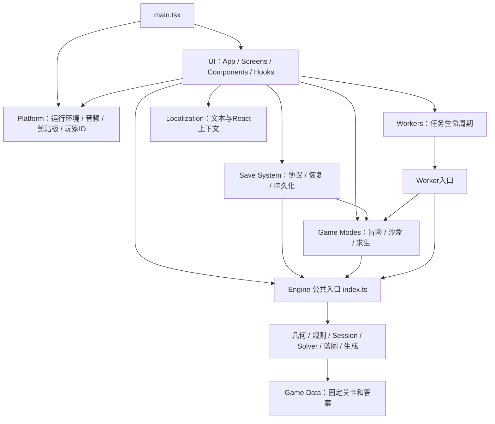
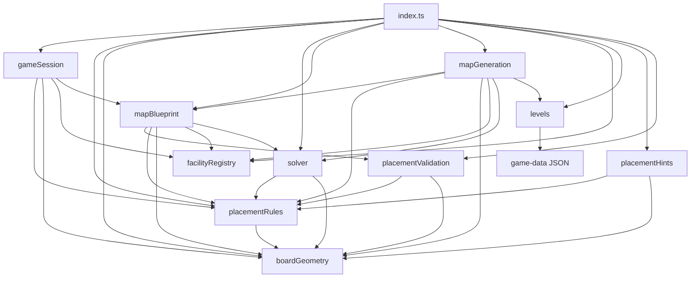
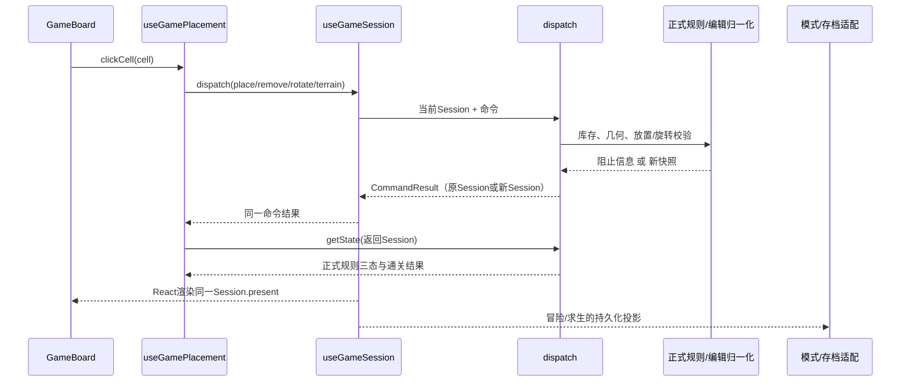
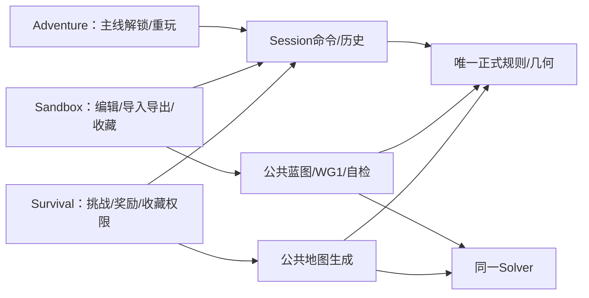
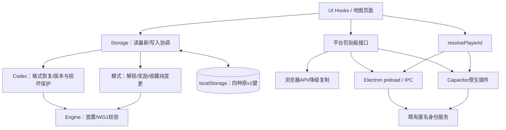

# Wildgrid（野格）实际架构

更新日期：2026-10-18（Asia/Shanghai）。本文描述第二阶段修改后的实际代码。第一阶段历史审计保留在 `reports/engine-*.md`；本轮新旧路径、清理依据和验证见 [第二阶段迁移报告](reports/phase2-migration.md) 与 [验证记录](reports/phase2-validation.json)。

## 目录与入口

```text
Wildgrid/
├── src/
│   ├── main.tsx                         Web/Electron/Android共用的React启动入口
│   ├── vite-env.d.ts                    Vite资源类型声明
│   ├── engine/                         纯TypeScript核心；唯一公开入口index.ts
│   │   ├── index.ts                    显式公开核心能力和类型
│   │   ├── types.ts                    关卡、设施、坐标、只读快照等契约
│   │   ├── boardGeometry.ts            形状、占格、旋转和邻接
│   │   ├── placementRules.ts           正式放置约束、关系、行列与三态/通关
│   │   ├── placementValidation.ts      strict/recover放置记录校验
│   │   ├── placementHints.ts           复用正式规则预测落点
│   │   ├── facilityRegistry.ts         稳定模板ID、设施形状及展示说明
│   │   ├── gameSession.ts              对局命令、80步历史、状态和操作查询
│   │   ├── solver.ts                   位集合搜索、唯一解检查和搜索统计
│   │   ├── mapBlueprint.ts             编辑归一化、完整蓝图校验、WG1编解码
│   │   ├── mapGeneration.ts            原有随机搜索与修复算法、预算和指纹
│   │   └── levels.ts                   45关和参考答案的ID查询
│   ├── game-modes/
│   │   ├── adventure/adventureProgress.ts 主线解锁、完成和重玩/恢复决策
│   │   ├── sandbox/
│   │   │   ├── localMapCollection.ts   地图命名/图标/收藏/编辑权限和纯变更
│   │   │   └── mapIcons.ts             稳定地图图标ID与校验
│   │   └── survival/
│   │       ├── survivalDifficulty.ts   十档难度、经验和身份阈值
│   │       └── survivalChallenge.ts    挑战生成入口、进度/替换/放弃/归档/结算
│   ├── save-system/
│   │   ├── adventureSaveCodec.ts       主线v1格式、默认值、恢复和版本保护
│   │   ├── adventureStorage.ts         主线读写与读取失败保护标记
│   │   ├── localMapSaveCodec.ts        本地地图v1解析、序列化及写前完整性保护
│   │   ├── localMapStorage.ts          地图持久化协调；业务交给模式模块
│   │   ├── survivalSaveCodec.ts        求生v1账本、WG1、历史和选择恢复
│   │   ├── survivalStorage.ts          读最新账本、调用结算并写入
│   │   └── tutorialStorage.ts          教学偏好、经验迁移、格式恢复与读写
│   ├── ui/
│   │   ├── App.tsx                    页面/弹窗/交互协调、教学和完成反馈
│   │   ├── screens/                   CampDiary、SandboxMenu、SurvivalMenu页面
│   │   ├── components/                GameBoard、图纸、手册、教学、SVG插画
│   │   ├── hooks/                     Session适配、输入、导航、模式IO和动画协调
│   │   ├── tutorial/tutorialLessons.ts 教学事件、目标、课程选择与完成决策
│   │   └── styles/                    原全局、视口、模式、字体、动画和教学CSS
│   ├── platform/
│   │   ├── audio/WildernessAudio.ts   Web Audio播放、解锁、后台暂停和生命周期
│   │   ├── clipboard.ts               Web/Electron/Android剪贴板统一接口
│   │   ├── playerId.ts                原生匿名玩家ID桥、缓存/超时协调
│   │   └── runtime.ts                 Android判断和生产离线缓存注册
│   ├── workers/
│   │   ├── workerTasks.ts             创建、消息、取消、超时和过期回复保护
│   │   ├── sandbox.worker.ts          调用Engine自检，不维护规则副本
│   │   └── survival.worker.ts         调用求生入口，最终复用Engine生成算法
│   ├── game-data/{levels,solutions}.json 原45关和参考答案（内容保留）
│   ├── localization/                 中英文、反馈/手册文本、日期与LanguageContext
│   └── assets/{fonts,survival-badges}/ 字体和SVG徽章
├── public/                            PWA图标、manifest与字体许可证
├── electron/{main,preload}.cjs         Windows窗口、协议、IPC与原生身份
├── android/                           Capacitor/Gradle、原生插件与资源
├── build/                             Windows图标和NSIS安装逻辑
├── server/                            既有玩家ID服务与部署说明；本轮不修改
├── scripts/                           构建、关卡创作、校验及部署维护入口
├── tests/                             规则、模式、存档、边界、Worker和既有UI测试
├── reports/                           历史证据、本轮映射与可复现基线
├── release/                           忽略的发布/恢复历史；保留
├── .desktop-smoke/                    忽略的维护脚本、截图和测试产物；保留
└── 根配置                             Vite、TypeScript、Electron、Capacitor与npm入口
```

Engine模块目前各有明确职责，未为单个文件机械创建七个子目录。沙盒使用公共蓝图和Session API，模式目录仅放实际存在的收藏/权限业务。没有模式基类、通用Repository框架、全局Engine对象或新状态管理依赖。

Web从 `index.html → main.tsx` 启动；Electron从 `electron/main.cjs` 以 `wildgrid://game` 加载同一份dist；Android由原生Activity/Capacitor加载dist。PWA只在生产HTTP(S)且非原生平台注册。打包配置和原生目录保持原入口。

## 全项目分层



箭头表示允许的源码依赖或实际任务调用。类型依赖也纳入循环检查。存档只向模式询问纯业务结果；模式不依赖存档IO。沙盒收藏读取显式传入的求生快照判断权限，不修改求生内部状态。翻译中的设施说明从公共Engine元数据读取；Engine不依赖翻译或React。

## 核心模块职责表

| 英文名称 / 中文名称 / 文件 | 负责；公开API | 不负责 | 允许依赖；调用者 |
|---|---|---|---|
| Engine API / 核心出口 `engine/index.ts` | 本文API表中的核心函数、只读类型和稳定查询数据 | 页面、存档协议、模式结算；不公开内部冲突编译细节 | Engine内部模块；UI、模式、存档、Worker、脚本/测试调用 |
| Board Geometry / 棋盘几何 `engine/boardGeometry.ts` | key、adjacent、offsets、occupied、rotateAround | 模式与设施关系规则 | 仅核心类型；规则、Session、Solver、蓝图、生成和公共API调用 |
| Placement Rules / 正式规则 `engine/placementRules.ts` | placementBlock、evaluate；内部共享设施/地形冲突及营地连接 | 搜索、存档、反馈播放 | 几何/类型；Session、Solver、提示、蓝图、生成调用 |
| Facility Registry / 设施定义 `engine/facilityRegistry.ts` | facilities、facilityLibrary、名称/提示/形状/地形说明 | 游戏合法性判断 | 核心类型；Session、蓝图、生成、UI/翻译调用 |
| Game Session / 对局 `engine/gameSession.ts` | createSession、dispatch、getState、getAvailableActions、MAX_HISTORY_STEPS | React订阅、存档、选中/悬停、动画 | 正式规则、几何、设施、编辑蓝图；useGameSession和输入Hook调用 |
| Placement Validator / 放置校验 `engine/placementValidation.ts` | validatePlacements strict/recover | 完成判定、解锁或奖励 | 正式规则/几何/类型；蓝图、模式、存档调用 |
| Solver / 求解器 `engine/solver.ts` | solveLevel、countSolutions；解与统计 | 独立玩法规则、平台任务取消 | 正式规则/几何；蓝图、生成、脚本/测试调用 |
| Map Blueprint / 地图蓝图 `engine/mapBlueprint.ts` | createSandbox、withEditorPlacements、checkSandbox、encodeMap、decodeMap；内部mapFingerprint | 存储键、剪贴板、异步Worker生命周期 | 设施、正式规则、Solver、放置校验；Session、模式、存档、Worker、UI调用 |
| Map Generation / 地图生成 `engine/mapGeneration.ts` | generateMap、MAP_GENERATION_TIMEOUT、MapGenerationSpec | XP、账本、收藏、挑战替换、时钟/随机设备种子获取 | 固定关卡、蓝图、正式规则、Solver；求生模式调用 |
| Adventure Progress / 冒险进度 `game-modes/adventure/adventureProgress.ts` | levelUnlocked、progressForPlay、recordAdventureProgress、completeAdventureLevel、adventureStartSnapshot；AdventureSave类型 | 序列化、localStorage、UI导航 | 公共Engine；主线Hook、日记、App和主线Codec调用 |
| Local Map Collection / 本地地图业务 `game-modes/sandbox/localMapCollection.ts` | 校验游玩进度、upsert/remove/rename/icon/unlock及survivalCollectionTarget | 隐式读求生存档、修改求生账本、重复实现几何规则 | 公共Engine、图标和求生快照类型；地图Codec/Storage及模式Hook调用 |
| Survival Difficulty / 求生难度 `game-modes/survival/survivalDifficulty.ts` | SURVIVAL_DIFFICULTIES、SURVIVAL_RANKS、rankFor | 生成算法、实际结算或存储 | 无运行依赖；求生流程、Codec、菜单/手册调用 |
| Survival Challenge / 求生挑战 `game-modes/survival/survivalChallenge.ts` | generateSurvival、survivalTotals、空存档/进度、归档、settleSurvival、更新/替换/放弃/重玩 | Worker创建、读盘、写盘、设备随机种子 | 公共Engine和难度表；求生Worker/Hook、存档适配器调用 |
| Save Codecs / 存档协议 `save-system/*SaveCodec.ts` | parse/serialize、strict写前保护、主线默认值与adventureSaveWritable | 再实现奖励、规则、解锁 | 公共Engine、模式模型/验证；Storage和测试调用 |
| Save Storage / 持久化 `save-system/*Storage.ts` | 主线/地图/求生读写、最新账本协调；tutorialStorage独立管理教学偏好 | 再实现奖励/解锁、控制Session、React状态 | Codecs、模式、Engine类型，教学可依赖纯Language类型；UI Hooks/地图页调用 |
| UI / 表现 `ui/` | 玩家输入、渲染、导航、弹窗、动画；useGameSession连接纯Session | 原地更改权威快照、创建Worker、读写localStorage、复制正式规则 | 公共Engine、模式、存档、任务、平台、翻译；main.tsx调用 |
| Tutorial Lessons / 教学课程 `ui/tutorial/tutorialLessons.ts` | matchesAction、finishLesson、resolveTutorial及UI目标/事件类型 | 偏好读写、棋盘规则 | 公共Engine类型、教学偏好契约、纯翻译类型；教学Hook/覆盖层调用 |
| Platform / 平台能力 `platform/` | audio统一实例、write/readClipboard、resolvePlayerId、isAndroidPlatform、registerOfflineCache | 奖励、模式解锁、棋盘状态 | Capacitor、DOM、Web Audio、原生桥及Engine设置类型；UI/main调用 |
| Worker Tasks / 后台任务 `workers/workerTasks.ts` | createSandboxCheckTask、createSurvivalGenerationTask；start/cancel/isRunning | 求解规则、页面反馈、存档替换 | Worker环境、公共Engine预算和类型；模式Hook调用 |
| Localization / 本地化 `localization/` | DICTIONARIES、翻译表、createTranslator、useI18n、LanguageContext、formatDateTime | 游戏规则和存储IO | 公共Engine展示元数据、React上下文；UI及教学偏好Language类型引用 |
| Game Data / 固定数据 `game-data/` 与 `engine/levels.ts` | levels、solutions、getLevelById、getSolution | 关卡流程、数据改写 | 原JSON；引擎生成、模式、UI、测试/创作脚本读取 |

## Engine内部依赖



所有模块另可依赖 `types.ts`。内部直接引用具体实现，不反向引用自己的barrel。外部只能导入 `engine` 或 `engine/index`。`facilityConflict`、`terrainConflict`、`campConnections`和连接要求表只供内部编译优化使用；公共出口不导出它们。

Solver仍用原位集合剪枝、候选域和相同设施去排列策略；正式规则提供几何和设施约束，完整候选继续 `evaluate` 复核。没有替换高性能算法。生成保留原十档搜索策略、随机调用次序、节点/时间预算；模式提供设施数量、基础关卡、多格要求，XP和奖励留在模式层。

## Session状态与放置调用链



`GameSession` 是纯数据值，包含只读 `mode/past/present/future`。`Snapshot` 的level、placements及嵌套的棋盘数组、坐标、设施、放置记录均通过TypeScript只读契约暴露。`getState()`不会返回可写的权威数组类型；关卡/答案查询也返回只读值。Engine输出通过命令替换，未按每次渲染做深拷贝或深冻结。

这是编译期边界，不是针对强制类型转换或无类型JavaScript的运行时防篡改机制。将外部数据交给 `createSession` 后应视为所有权转交，不能继续通过原来的可写别名修改它。仅WG1解码器私有的新蓝图和生成器已有的独占克隆使用可写构造类型，该类型不经公共入口导出。没有让UI通过类型断言修改快照。

`useGameSession`的ref与React state持有同一个Engine返回值；ref解决同一事件内连续命令读取旧值的问题。历史只有Engine一份；存档是恢复投影。`getState`重新计算派生规则结果，不产生第二份可操作局面。关卡/快照对象身份保留，教学和庆祝依赖的引用比较保持原顺序。

| 命令 | 参数 | 行为 |
|---|---|---|
| place | piece、cell、rotation | 正式模式从关卡库存取真实设施；编辑模式可建立注册表允许的实例 |
| remove | id | 正式模式回库存；编辑模式同步归一化设施和目标 |
| rotate | id、pivot | 保留原占格支点算法，阻塞时返回原Session |
| terrain | cell、可选kind | 仅编辑模式；切换同种地形或省略kind时移除 |
| clear | 无 | 清设施，可撤销；编辑模式保留地形、清空设施目标 |
| undo / redo | 无 | 共用MAX_HISTORY_STEPS=80，分支操作清空future |

关系错误和行列错误保持可编辑，只有格式、库存、越界、地形覆盖和设施重叠等原有条件阻止命令。`CommandResult`包括session、error、cells、events；拒绝不生成新权威状态。悬停、预览、选择、未落子方向和临时ID属于UI，预览dispatch结果不提交。

## 三种模式和公共核心



冒险保持两条解锁链、完成进度、未完成布局恢复和已解关卡重入重置。沙盒保留尺寸、地形/设施编辑、保存/导出前唯一解自检和WG1导入；导入游玩不改主线或求生经验。收藏的求生原图不等于活动挑战，编辑权限由显式求生快照和收藏元数据决定。

求生只有一个活动挑战；生成成功并成功保存后才替换旧挑战。失败/取消保留旧挑战；放弃归档并解锁图纸，不奖励完成。结算读取最新账本、验证正式通关并按挑战ID幂等计奖；写失败不会报告奖励成功。历史、方向和选择沿原协议恢复。

## 存档与平台数据流



| 协议 | 保持的格式与保护 |
|---|---|
| wildgrid-save-v1 | version=1、completed/current/progress/settings不变；recover跳过坏放置，读失败标记与未知版本防覆盖保留 |
| wildgrid-local-maps-v1 | version=1与maps/code/progress/source/survival不变；读取可恢复有效地图，写入前拒绝覆盖不完整原列表 |
| wildgrid-survival-v1 | version=1、completed/records/recent/challenge/progress不变；challenge仍存WG1；80步历史、40指纹和损坏/未来版本保护保留 |
| wildgrid-tutorial-v1 | 教学开关/语言/已见课程和设施/跳过/活动步骤字段不变；原经验迁移和失败返回值保留 |
| WG1: | v/s/t/f/r/c、稳定模板和实例ID、UTF-8 JSON、无填充Base64URL和原错误消息不变 |

蓝图验证和WG1是通用地图数据契约，继续由Engine统一实现；地图导入/导出的交互、唯一解任务及剪贴板由沙盒Hook协调。Codec不执行奖励/解锁计算。教学课程与DOM目标属于UI，只有偏好读取/写入和旧进度经验推导在存档系统。

`workerTasks.ts`内的共享任务机制只服务两个真实消费者。每个任务实例同时只有一个Worker；完成/错误/取消/超时释放Worker和计时器，旧Worker的迟到或重复消息通过实例身份被忽略。求生继续25秒外层超时、原24秒内部生成窗口；沙盒不新增超时预算。剪贴板异步完成仍由沙盒revision检查，编辑/离开后不会发布旧导出反馈。

## 公共Engine API参数与结果

以下均从 `src/engine/index.ts` 导入；类型参数中的数组接受只读数据。

| API | 参数 | 返回结果 / 用途 |
|---|---|---|
| createSession | {mode,present,past?,future?} | GameSession；开始/恢复一局并截取80步历史 |
| dispatch | session, GameCommand | CommandResult；唯一棋盘命令及撤销/重做 |
| getState | session | {level,placements,result}；只读权威快照及evaluate派生值 |
| getAvailableActions | session | {undo,redo,pieces}；历史按钮和未放库存 |
| MAX_HISTORY_STEPS | 常量，无参数 | 80；Session及求生存档共用历史上限 |
| key | Cell | string；r,c坐标键 |
| adjacent | a,b,diagonal=false | boolean；四邻域或八邻域 |
| offsets | shape,rotation | Cell[]；归一化形状占格 |
| occupied | piece,placement | Cell[]；棋盘实际占格 |
| rotateAround | piece,placement,pivot | Placement；沿原支点旋转 |
| placementBlock | level,placements,candidate | string或null；几何阻止原因 |
| evaluate | level,placements,{staticOnly?}={} | {rows,cols,issues,won,status}；正式规则、依赖关系及完成状态 |
| validatePlacements | level,unknown,mode='strict' | {placements,error}；严格输入/历史校验或recover恢复 |
| placementHints | level,placements,piece,rotation,baselineIssues | 坐标→Status；复用evaluate预测落点 |
| getLevelById | id | 只读Level或undefined；稳定ID查询 |
| getSolution | id | 只读Placement[]或undefined；参考答案 |
| levels / solutions | 只读查询数据，无参数 | 45关列表/ID答案表；原公开名称保留 |
| facilities / facilityLibrary | 定义列表/稳定模板，无参数 | UI展示、合法设施形状和WG1模板；不执行规则 |
| facilityNames / facilityTips / shapeNames / terrainNames | 只读查询元数据，无参数 | 名称和说明；原公开名称保留 |
| solveLevel | level,limit=2,{deadline?,maxNodes?}={} | SolverResult；count/solutions/aborted及搜索统计 |
| countSolutions | level,limit=2 | number；同一Solver的计数查询 |
| createSandbox | size:6或8 | SandboxDraft；空的只读编辑快照 |
| withEditorPlacements | draft,placements | SandboxDraft；批量蓝图构造/设施和行列目标归一化 |
| checkSandbox | draft | {status,message}；invalid/none/multiple/unique |
| encodeMap | draft | WG1字符串；严格校验后编码，可抛原异常 |
| decodeMap | string | SandboxDraft；严格解码和蓝图校验，可抛原异常 |
| generateMap | difficulty,seed,id,recent,spec | {id,difficulty,seed,draft,fingerprint}；原有生成算法。spec={min,max,bases,multi}由模式提供 |
| MAP_GENERATION_TIMEOUT | 常量，无参数 | 25000；原后台生成超时 |

公开类型包括 Cell、Terrain、Piece、Placement、Level、Snapshot、GameMode、FacilityKind、Shape、Status、Issue、Settings、FacilityDefinition、GameSession、GameCommand、GameEvent、CommandResult、PlacementValidationError/Result、SolverResult、SandboxDraft/Check、MapGenerationSpec。Settings暂保留原共享类型契约，Engine不读取设置或管理UI。

```ts
import { createSession, dispatch, getLevelById, getState } from './src/engine';
let session = createSession({ mode: 'adventure', present: { level: getLevelById(1)!, placements: [] } });
const outcome = dispatch(session, { type: 'place', piece: session.present.level.pieces[0], cell: { r: 2, c: 3 }, rotation: 0 });
if (!outcome.error) session = outcome.session;
const { placements, result } = getState(session); // 不得原地修改placements
```

模式与协议API从各自文件直接导入，不建立第二套模式barrel或旧路径兼容层。核心命令、规则、Solver、蓝图API名称/参数语义保持；第一阶段混入Engine的模式和协议导出已迁到上表对应模块。生成模式入口 `generateSurvival(difficulty,seed,id,recent?)` 保留原签名，改从 `game-modes/survival/survivalChallenge` 导入；Engine提供接收模式规格的 `generateMap`。`Save`类型改为明确的 `AdventureSave`，序列化字段不变。详情见迁移报告。

## 命名与术语

目录用kebab-case，普通逻辑文件camelCase.ts，React组件文件PascalCase.tsx，类文件PascalCase.ts，类型/接口PascalCase，函数/方法camelCase，Hook以use开头。固定表/阈值/存储键使用UPPER_SNAKE_CASE，例如SURVIVAL_DIFFICULTIES、MAP_ICON_CHOICES、MAX_HISTORY_STEPS、STORAGE_KEY；运行中对象如audio、LanguageContext不是固定配置表。既有公共Engine查询数据名levels/facilities等保留，避免无必要的核心接口变更。Android/Gradle/Electron遵循原生工具链约定。

| 术语 | 中文 / 本项目含义 |
|---|---|
| Engine | 引擎；不依赖React、DOM、localStorage或原生运行时的游戏核心 |
| Session | 对局；一次棋盘及其命令/历史生命周期，使用纯数据和函数，无巨型类 |
| Snapshot | 快照；只读level与placements，共享对象身份，不是UI状态副本 |
| Controller | 协调者；如useGameSession协调输入结果和React提交，不另实现规则 |
| System | 系统；有明确职责的独立机制，例如存档系统；不强制创建同名类 |
| Service | 服务；实际外部能力，例如既有玩家ID服务；不为纯函数增加Service后缀 |
| Repository | 仓储；数据持久化边界。本项目简单存储直接使用Storage函数，没有Repository类 |
| Validator | 校验器；格式/放置合法性验证，复用正式规则，不另定玩法 |
| Generator | 生成器；Engine的原有地图随机搜索和修复算法 |
| Solver | 求解器；正式规则驱动的高性能解搜索与唯一解检查 |
| Registry | 定义注册；设施模板/支持形状/说明的唯一来源，非规则副本 |
| Renderer | 渲染器；GameBoard/SVG等表现代码，不拥有可写局面 |
| Codec | 编解码器；v1存档或WG1格式的转换/恢复，不计算奖励 |
| Storage | 持久化；读写与错误保护，向模式/Codec委派业务和格式判断 |

新设施先修改核心类型、facilityRegistry和正式规则；Solver优化继续从正式约束编译。新模式复用Session及公共蓝图/求解能力，模式业务留在game-modes。新增存储字段必须考虑旧v1和损坏数据，不能因代码改名更改协议。

## 验证与实际限制

`tests/engine-boundaries.test.ts`检查全部src层级、外部依赖、核心私有路径、静态/动态导入、require、Worker URL、UI创建Worker和模块循环。`tests/engine.test.ts`保留命令/历史测试，并用TypeScript预期错误验证嵌套只读契约。`tests/worker-tasks.test.ts`覆盖取消、迟到/重复结果、错误、postMessage失败和原25秒超时。

`node --import tsx scripts/check-engine-preservation.ts`使用源码修改前记录的 `reports/phase2-engine-baseline.json`，比较45关完整Solver输出摘要、779次规则判定与45个WG1字节摘要。第12/14/15关在基线即有多个解；第16–45关要求并保持唯一解。没有通过修改关卡或规则消除这些基线特征。

全量测试的4项既有失败、最高难度生成超时、Vite原大chunk提示和无法完成的平台/UI验证须按本轮验证报告阅读；构建通过不等于Windows安装/升级、Android真机或真实身份服务已验证。本轮未部署、未修改服务器/玩家数据，未执行Git提交/推送/reset/clean。
