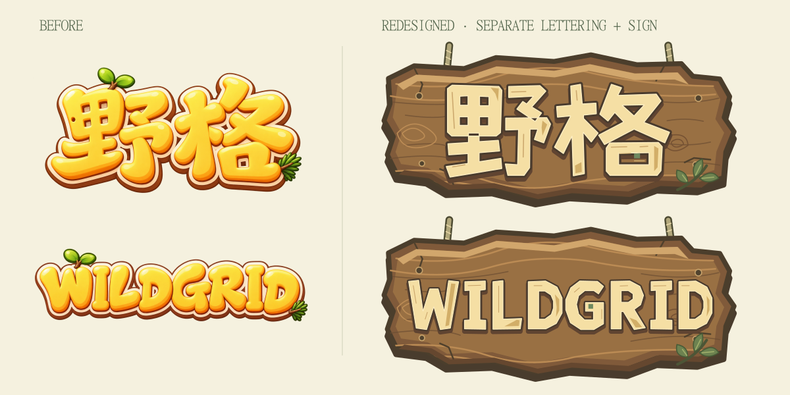

# 野格：美术资产化与品牌重设计交付

日期：2026-10-19。基于工作区已有的未提交改动继续实施；未执行 commit、push、reset、clean。保留已有森林插画、身份徽章、首页入场和奖励动画工作。

## 结果与视觉预览

中文、英文与木牌均为新设计的独立 SVG。字形由路径构造，不使用字体、系统字形、文字描边替代设计，也没有把首页合成一张图。

旧版是高饱和、圆润膨胀的黄色字标，文字与小植物结合，没有独立的大招牌。新版以宽厚的木刻几何笔画、削角、浅麦色表面和短棕色厚度层建立识别；“野”的四处留白和“格”的方形内部呼应棋盘。中英文分别绘制，不机械替换文字。英文对长单词单独控制字宽、节奏与间距，G 的局部绿色格块与中文统一。

招牌使用不规则削边、局部缺口、手绘木结和随形木纹；有短编绳、少量木钉和一支小叶，中心保留字标区域。木牌与两种字标通过独立图片叠放，切换语言只更换文字图片。

- [中文移动端首页](art-preview/home-zh-mobile.png)
- [英文移动端首页](art-preview/home-en-mobile.png)
- [中文桌面首页](art-preview/home-zh-desktop.png)
- [日记章节](art-preview/diary-chapter.png)
- [野外手册](art-preview/field-guide.png)
- [荒野求生奖励弹窗](art-preview/survival-reward-mobile.png)

## 完整清单与页面对应

机器可读的逐文件清单位于 [art-inventory.json](art-inventory.json)，包含路径、状态、大小、固有尺寸、SHA-256，以及全部 35 个 TSX/CSS 源文件的扫描结果和保留的运行时 SVG 原因。

共检查 162 张源图片：新增 151 份 SVG、原样复用 9 份已有图片、保留 2 份旧 Logo 用于对比。生产包实际包含 160 张图片（156 SVG + 4 WebP），共 1,580,865 字节；新增 SVG 合计 650,973 字节。字体不计入这个图片统计。另有 20 份 PWA / Windows / Android 平台图标已审计并保留，见清单的 `packagingAssets`。

| 资源 | 数量与处理 | 使用页面 / 组件 |
| --- | --- | --- |
| `src/assets/branding/logo-zh.svg` | 重绘，600×260 | 中文首页 `GameTitle` |
| `src/assets/branding/logo-en.svg` | 重绘，880×190 | 英文首页 `GameTitle` |
| `src/assets/branding/title-sign.svg` | 重绘，无字底板，720×330 | 两种语言共用的首页招牌 |
| `backgrounds/home-woodland.webp`、`home-woodland-portrait.webp` | 复用 2 张 | 横屏 / 竖屏首页 |
| `backgrounds/camp-diary.webp`、`wilderness-survival.webp` | 复用 2 张 | 日记入口、荒野求生菜单 |
| `backgrounds/chapter-0.svg`–`chapter-2.svg` | 迁移 3 张 | 三章关卡选择、生成页面背景 |
| `backgrounds/*-wash.svg` | 新增 4 张可替换底色背景 | 通用页面与三章外部背景 |
| `backgrounds/home-vignette.svg`、`generation-vignette.svg` | 迁移 2 张 | 首页 / 地图生成页的柔和遮罩 |
| `illustrations/journal-01.svg`–`journal-45.svg` | 迁移 45 张，保留原场景 | 日记关卡封面、普通通关弹窗 |
| `illustrations/chapter-{0,1,2}.svg` 及 `-cloud` / `-ripples` | 迁移并拆层，共 9 张 | 三章入口卡片；云与水纹继续动画 |
| `illustrations/hero-island.svg` | 迁移 1 张 | 首页浮岛静态层 |
| `illustrations/adventure.svg`、`sandbox.svg` | 迁移 2 张 | 模式页面插画 |
| `objects/*.svg` | 11 个完整对象 + 7 个动画分层 | 棋盘、工具栏、地图图标、首页树冠 / 火焰 |
| `icons/menu-*.svg`、`tool-*.svg` | 迁移 24 + 7 张 | 模式选择、本地地图、手册、营地操作按钮 |
| `survival-badges/*.svg` | 原样复用 5 枚 | 身份面板、升级弹窗 |
| `achievements/completion-landscape.svg` | 迁移 1 张 | 通关景框与枝叶 |
| `achievements/check-medallion.svg` | 资产化 1 张 | 通关确认圆章 |
| `achievements/challenge-difficulty.svg`、`challenge-count.svg` | 迁移 2 张 | 奖励弹窗的难度、通关次数图案；数字仍为动态文本 |
| `progress/xp-frame.svg`、`xp-base.svg`、`xp-gain.svg`、`xp-leaf.svg` | 资产化 4 张 | 身份与奖励经验条；进度和增长逻辑保留 |
| `progress/generation-stripe.svg` | 资产化 1 张 | 地图生成进度动画 |
| `panels/*.svg` | 9 张 | 通关、奖励、身份、三章卡片、手册封面、纸页边缘、横线纸 |
| `decorations/*.svg` | 15 张 | 云、鸟、火光、入场火光、枝叶、草、装订环、书签、分隔线与通关动效 |

旧 `branding/wildgrid-zh.webp` / `wildgrid-en.webp` 没有删除，以保留工作区原有设计成果；注册表仅引入 branding SVG，它们不进入生产包。公共启动图标、Windows / Android 应用图标及字体未改动。

## 架构与替换方法

沿用现有 `src/assets`，没有再建立平行的 `art` 资源目录。`src/assets/art.ts` 管理组件图片，`src/assets/art.css` 管理 CSS 材质与九宫格皮肤。

1. 用同名文件覆盖对应资源，保持 viewBox、透明留白与对齐位置。
2. 常规替图不需要改业务 TSX 或绘画 CSS；重新构建即可。
3. 中文 / 英文 Logo 与招牌分离。更换其中一个不会影响另外两个资源。
4. 96×96 面板保留 16 单位九宫格边缘；XP 槽 96×32，切片边缘 12 单位。四角不拉长，中间平铺 / 拉伸。
5. 装订纸张是 64×64 纹理平铺；普通插画、Logo 和图标等比显示，背景根据场景使用 cover。
6. 动画覆盖层保持完整画布，不能裁掉透明边。运动只施加到对应图片层。
7. `vite.config.ts` 的 `assetsInlineLimit: 0` 保证小 SVG 也输出为独立文件。所有资源随离线缓存、Electron 和 Capacitor 打包，没有新增依赖或在线图片。

普通图片加载失败不会抛出业务异常；Logo 缺失时保留可读标题回退。图片解码和实际包内文件完整性均已核对。

## 已清理的绘画代码

- `GameTitle` 旧字标引用换为新 Logo + 新底板。
- `Art` 的 11 种静态设施 / 地形插画改为图片；保留随形状、旋转计算的占地、屋顶和设施构造。
- `ChapterArtwork`、`JournalLevelSceneArt`、`JournalChapterBackground`、`SandboxArt`、`MenuIcon`、`CampToolIcon` 的静态 JSX 矢量绘画迁出。
- 删除迁移后不再使用的 `JournalSceneObjects.tsx`、`journalSceneDesigns.ts`，以及由本次迁移变成无用的 `getJournalChapterArt`。场景本身保存在 SVG 中。
- `HeroArt` 静态浮岛、树、火、云、鸟移为图片；SVG 容器用于坐标与动画，唯一保留的绘画路径是连续移动的水流虚线。
- `CompletionEmblem`、`SurvivalRewardPanel` 中的风景、奖励标记与 XP 叶片迁出。
- 删除手册封面与纸页的重复渐变纹理、CSS 装订环与伪元素、clip-path 书签，以及卷页多层阴影绘画；以纸张、书签、装订环与九宫格替换。
- 删除通关面板背景渐变、多层装饰内框阴影、径向渐变叶片；替换为面板和枝叶资源。
- XP 槽 / 轨道与填充、生成条纹、身份面板、章节卡片的静态材质、首页和生成页遮罩迁为资源。
- 通用页面多层 box-shadow 背景圆环改为两张独立图片。
- 棋盘空格中的两条 CSS 草叶改为 `decorations/grass.svg`。
- 删除迁移后失效的树冠 / 火焰路径选择器，改为对图片层应用相同类别的动画。

发现原有 `.win-emblem` 旧样式已无当前组件使用，本次保留，避免清理与本次迁移无关的旧代码。

保留的 CSS：Flex/Grid、定位、响应式与滚动、安全区、基础颜色、按钮的普通表面渐变和按下 / 悬停 / 禁用反馈、焦点、页面和弹窗动画、入场光带、粒子、程序水流、经验增长、棋盘边界与合法 / 错误提示。保留的内联 SVG 是动态设施轮廓、蓝图、教程聚焦 / 示例和首页动画舞台，不把它们计作静态资源迁移结果。

## 验证记录

| 检查 | 结果 |
| --- | --- |
| `npm run build`（含 `tsc -b`） | 通过；Vite 有 JS chunk 大于 500 kB 的提示，未为美术任务引入无关拆包改造 |
| `node scripts/audit-art.mjs` | 162 张源图像全部解码；SVG 内部引用完整、没有未解析 CSS 变量 / 在线引用；两种 Logo 不含字体文字 |
| `home-visual-smoke.cjs` | 通过；中英文实时切换，1280×900 / 390×844 / 844×390 / 320×568；桌面 DPR 2；生产包全部 160 张图片均经 Chromium 解码；首页、设置、手册、日记、章节、模式、求生、通关布局与水流 / 减少动态效果 / 可见性暂停验证 |
| `art-upgrade-ui.cjs` | 通过；中英文各 1280×720 / 1024×600 / 390×844 / 360×640 / 320×568 / 844×390；安全区、按钮无挤压、XP 跨身份增长、最高身份、重玩去重、关闭清理、减少动态效果 |
| `journal-art-ui.cjs` | 通过；三章 45 张封面、桌面 / 竖屏 / 横屏、中英文、锁定 / 当前 / 完成状态、共享通关插画与存档不变 |
| `tutorial-art-ui.cjs` | 通过；中英文正确 / 错误示例使用合法 SVG image 元素，继续引导正常 |
| 现有完整 `tutorial-ui.cjs` | 未通过：该旧脚本首步期待 `board`，当前未改动的教程配置首步为 `welcome`。本次未改教程流程或重写整套旧用例；已对实际受迁移影响的示例另做定向验证 |
| Windows NSIS x64 | 通过；`release/Wildgrid-Setup-1.0.0-x64.exe`，117,016,159 字节 |
| 打包后 Windows 离线启动 | `desktop-smoke.cjs` 通过；`wildgrid:` 协议下 Logo / 木牌加载正常，按钮位于插画下方 |
| Android Capacitor 同步 + Gradle `assembleDebug` | 通过；`release/野格-v1.0.0.apk`，10,359,694 字节 |
| 包内资产一致性 | Windows app.asar 和 Android APK 中全部 160 张生产图片，逐文件 SHA-256 均与 dist 一致 |
| 核心业务范围 | `src/engine`、`src/game-data`、`src/game-modes`、`src/platform` 无本次改动；没有修改规则、关卡、存档格式和成就算法 |

已实际查看中英文首页、章节、手册和奖励截图，并修复竖屏招牌宽度、SVG 分组闭合、横屏落叶覆盖层引起的滚动问题。Windows 初次打包与 Android 初次构建遇到缓存权限限制，最终使用本机已有工具缓存和构建权限完成。

Android 视觉验证是 Chromium 的移动尺寸 / 触摸或 Android UA 模拟，不等同于真机巡检；本轮未连接 Android 真机，也未进行帧率或内存基准测试。静态场景从 React 绘制树移出，但不将这一点冒充已测得的性能提升。

## 人工美术待办

本轮没有需要人工补图才能运行的占位资产，也没有把工具未能完成的插画标为完成。背景、身份徽章与 45 张场景保留既有美术；新字标与木牌是可直接使用和独立编辑的矢量成稿。最终品牌审美可依据新旧对比和实际首页截图审阅。
