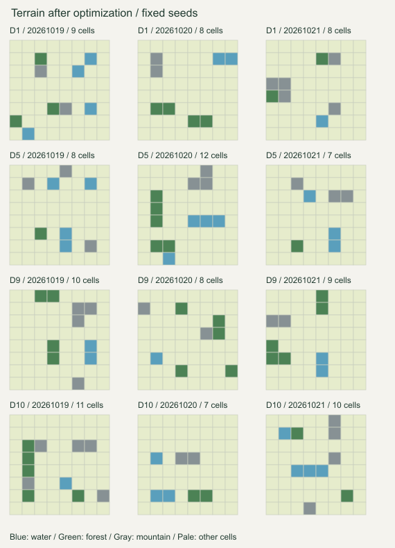

# 荒野求生地形优化验证（2026-10-20）

本报告对应本次地形优化；此前 `generator-refactor.md` 中的地形数量和耗时属于旧实现，不代表当前参数。

## 根因与修改范围

旧 `planTerrain()` 的预算接近 28 格，初始使用预算的 78%–100%；河流长度还随设施数增长。生成答案后，旧细化逻辑可再追加最多四格。已有连通块、集中度指标主要用于软扣分，没有总量、三类数量及滑动窗口的硬门槛。结果是 20–28 格固定地形、多格长河、不同地形混杂的高密度区域。大批候选到逻辑求解阶段才发现不合适，也浪费了计算。

本次修改源码：

- `src/engine/mapGeneration.ts`：优化现有 `planTerrain()`，约束边界细化；对多格需求较高的布局提前设置随机行列容量，缩小无效放置域。
- `src/engine/mapQuality.ts`：集中 `TERRAIN_LIMITS`；新增 `terrainPlacementScores()`、`terrainDistribution()`；复用 `terrainRegions()`，在 `mapQuality()` 中区分硬限制与软评分。
- `src/engine/facilityConstruction.ts`：集中 `ACTIVITY_LIMITS`，按实际可用行列及未禁用多格形状的最小面积剪枝，保留内部空草地，不要求铺满。
- `tests/map-generation.test.ts`：增加合并连通块、边缘窗口、3×3 合格但 4×4 超密、半区偏斜、总量、种子变化及难度解耦验证。
- `scripts/check-generation-rework.ts`：增加 `--terrain` 固定样本与轻量规划统计模式，复用现有验证脚本。

审查了 `workerTasks.ts`、`survival.worker.ts`、`useSurvivalChallenge.ts`、生存挑战入口、设施域、求解与自检调用。Worker、UI、存档、WG1、营地日记、正式放置规则和难度表均未因本次优化修改。保留上一轮已经完成的单格营地硬约束及原工作区变更。

## 数量与自然变化

先按种子选择通常 7–13 格的总预算，少量选择 14 格，再结合实际设施最低占地和可用类型收紧预算。总量硬上限为 15；水、森林、山地分别最多 4、5、5 格，按各自剩余额度随机分配，不设固定配额。因此当前三类独立上限合计最多 14，15 是防御上限，不是每局追求的目标。

预算不依赖难度编号递增。难度只通过不可违背的设施面积需求限制物理容量；在当前 1–10 难度范围，这不会把高难度地形数量推高。测试还验证了同一个规划种子在 4 个设施/0 多格与 18 个设施/6 多格需求下得到相同地形计划。

水源至少保留一格以支持营地；森林、山地允许缺席，禁用木屋、瞭望塔后也相应降低其地形需求。实际没有对应地形时，共享合法域不会选入依赖该地形的设施。聚集偏好、随机扰动和山林相邻偏好共同产生零散地貌、小池塘、短水道、小山脉和山林相依，没有五套固定模板，也没有强制最小间距。

## 密度、连通块与设施适配

每次放置地形时，先建立当前窗口计数，再给最多 64 个位置打分：

- 同类正交连通块最多 **3 格**；合并已有不同小块也计算合并后的总大小。本次无需启用 4 格例外。
- 所有滑动 **3×3 最多 4 格、4×4 最多 8 格**，包括紧贴边缘的窗口。
- 规划时按本局预算限制象限与半区数量；最终达到常规数量时，单象限不超过总量的 60% 向下取整，任一上/下/左/右半区不超过 85% 向上取整。
- 在硬限制内，集中、半区偏差和高窗口密度降低评分；允许局部邻接和不同地形相依。不会要求四象限等量，也不会把单格地形全部判为低质量。

答案后的地形细化最多 **一次**，只能使用预先留下的预算；与初始规划共享同一套数量、连通块和密度限制。细化保护所有答案占格、森林禁火条件及餐车空草地间隔，变更后重建完整候选域。不存在为了补足设施条件持续追加地形的路径。

减少地形后，仅维持原设施搜索会增加自由角色互换和逻辑停滞。对多格下限至少 4 的构造，现在随机选择 6–7 个可用行与列，先安排少量零提示行列作为明确推理入口；位置可在内部或边缘，不固定某条边。所有设施仍来自正式共享放置域，实际占格数形成最终提示，活动区域内部也保留至少两格空草地，不做强制铺满。

零行列容量不是游戏新增规则，而是本次答案构造的选择；最终谜面及独立求解器看到的是实际行列提示。复用候选域时，最终提示必然不超过规划上界，不能漏掉合法替代解。设施数量、多格下限、禁用项和单格营地没有放宽。`reasonLevel()` 与 `solveLevel()` 的推理/证明算法未修改。

## 有限固定样本

默认样本固定为每个难度三个种子：**20261019、20261020、20261021**，不换种子补成功。另有三个禁用组合，总共 15 次完整生成。

| 难度 | 旧地形数量 | 新地形数量 | 旧平均 ms | 新平均 ms | 新成功数 |
|---|---|---|---:|---:|---:|
| 1 | 27 / 23 / 24 | 9 / 8 / 8 | 19.7 | 18.3 | 3/3 |
| 5 | 27 / 27 / 28 | 8 / 12 / 7 | 60.3 | 113.3 | 3/3 |
| 9 | 27 / 28 / 26 | 10 / 8 / 9 | 2263.3 | 513.3 | 3/3 |
| 10 | 23 / 23 / 失败 | 11 / 7 / 10 | 2777.7 | 1238.0 | 3/3 |

平均时间包含同一固定样本集中的失败消耗。难度 10 的设施数为 **18 / 18 / 20**，多格数为 **6 / 6 / 8**，单格营地每张都实际存在。

额外三个案例均使用种子 20261019：

| 难度与禁用项 | 新地形数 | 耗时 ms | 结果 |
|---|---:|---:|---|
| 难度 1，禁用 camp_single | 7 | 5 | 含多格营地与泳池，无单格营地，合法且唯一 |
| 难度 10，禁用 camp_single | 7 | 2682 | 18 个设施、6 个多格，无单格营地，合法且唯一 |
| 难度 10，禁用 camp_el、foodTruck_single | 7 | 2396 | 18 个设施、8 个多格，严格排除禁用项，合法且唯一 |

15 张成功地图均完成实际规则检查、原逻辑求解及新建候选域的独立唯一解复核。样本包含泳池、林间木屋、L 型营地及单/多格混合营地。

| 指标 | 修改前 | 修改后 |
|---|---:|---:|
| 成功率 | 14/15 | 15/15 |
| 全部样本累计生成时间 | 18865 ms | 10732 ms（减少约 43%） |
| 中位生成时间 | 319 ms | 204 ms |
| 最长生成时间 | 3632 ms | 2682 ms |
| 成功地图地形数：最小/最大/均值 | 20 / 28 / 25.43 | 7 / 12 / 8.53 |
| 水源数量：最小/最大/均值 | 5 / 10 / 7.07 | 1 / 4 / 2.40 |
| 森林数量：最小/最大/均值 | 6 / 12 / 8.21 | 1 / 5 / 3.07 |
| 山地数量：最小/最大/均值 | 7 / 14 / 10.14 | 2 / 5 / 3.07 |
| 最大水/森林/山地连通块 | 10 / 7 / 7 | 3 / 3 / 3 |
| 最大 3×3 / 4×4 密度 | 9 / 13 | 4 / 6 |

另外对 **96 个连续固定种子**执行轻量地形规划，不运行完整地图求解：数量 7–14、均值 9.52；数量直方图为 7:19、8:21、9:12、10:13、11:8、12:13、13:9、14:1。全部符合硬限制；76 个计划包含双/三格聚集，20 个全部为单格，连续全部孤立的最长段为 3。实际成功地图只有 1/15 为全部孤立，其余均含小块组合。规划统计不能冒充 96 张完整唯一解地图。

下图展示十二个默认成功样本的固定地形；浅色表示其他格子，**包含设施格，不能视为全部空草地**。

## 验证与复现

- TypeScript：`node node_modules/typescript/bin/tsc --noEmit`，通过。
- 针对性测试：`node node_modules/tsx/dist/cli.mjs --test tests/map-generation.test.ts tests/worker-tasks.test.ts tests/sandbox.test.ts`，**21 项通过**。
- 完整固定样本：`node node_modules/tsx/dist/cli.mjs scripts/check-generation-rework.ts terrain-after --terrain`。输出逐张设施清单、时间、失败原因、连通块和密度，并验证正式规则、唯一解和必需/禁用设施。
- 统计脚本也会输出 96 个轻量规划样本、数量直方图、孤立连段及耗时分布；支持在第三个参数传入难度进行小范围复核。
- [完整原始数据、地图码与统计](terrain-optimization-results.json)。

Worker 取消、后台暂停/恢复、超时、旧结果隔离均由已有回归测试覆盖。当前版本原本就没有失败后自动循环换种子的机制，原有测试明确要求失败后停止；本次保留手动重试取新种子、暂停恢复保留原种子的行为，没有擅自增加自动后台重试。

## 限制

- 小样本不能保证任意种子和任意禁用组合都成功；仍保留固定搜索节点、尝试数和总超时，预算不足会明确失败，不能返回未经证明的地图。
- 不是每个案例都更快：难度 5 平均从 60 增至 113 ms，禁用 L 型营地及餐车的难度 10 案例也明显慢于基线。整体耗时与最长耗时改善，不代表逐个种子无回退。
- 高难度的零提示行列是当前构造的结构偏好；改善了推理入口与性能，但减少了这部分谜面布局的自由度。它不固定地形形状，也不要求设施填满剩余区域。
- 本次采用严格三格连通块，不启用四格特殊例外。自然程度仍是软评分和目视检查；逻辑路径通过不等于真人趣味评测通过。

未执行 commit 或 push；没有改变已有存档和游戏规则。
